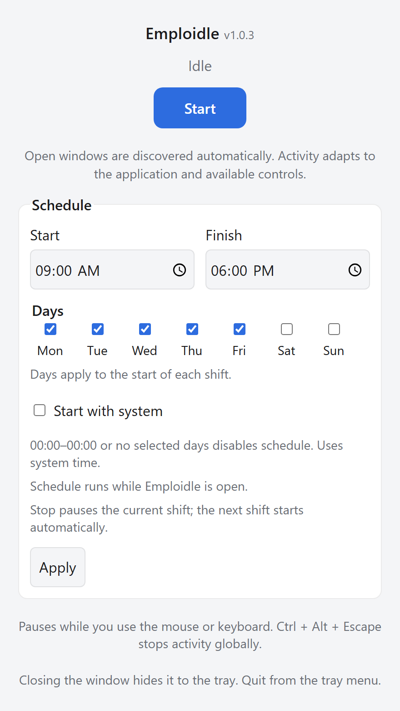
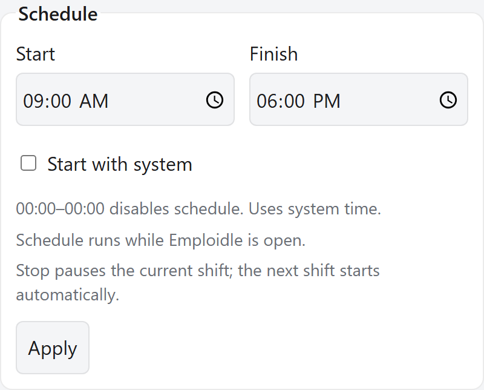
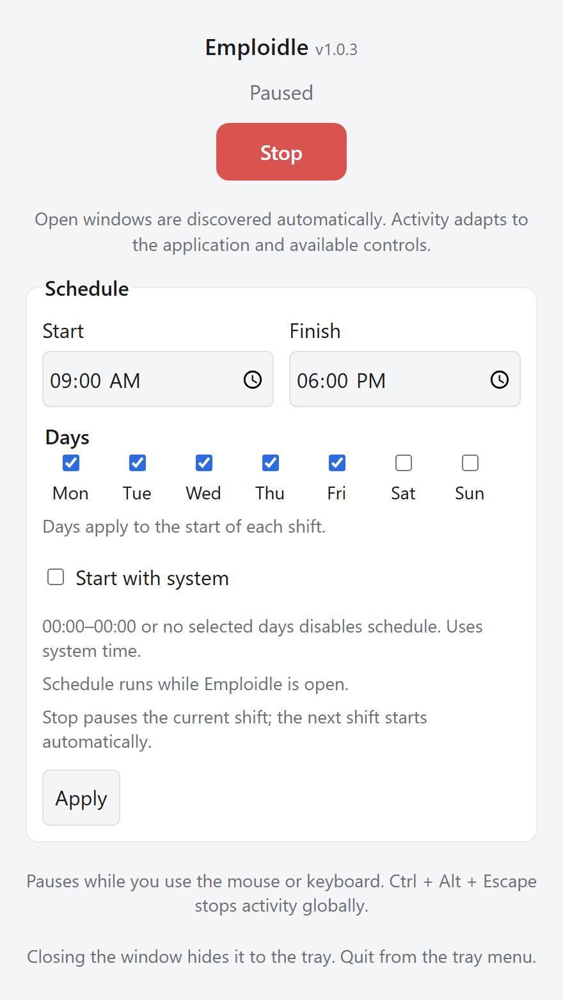
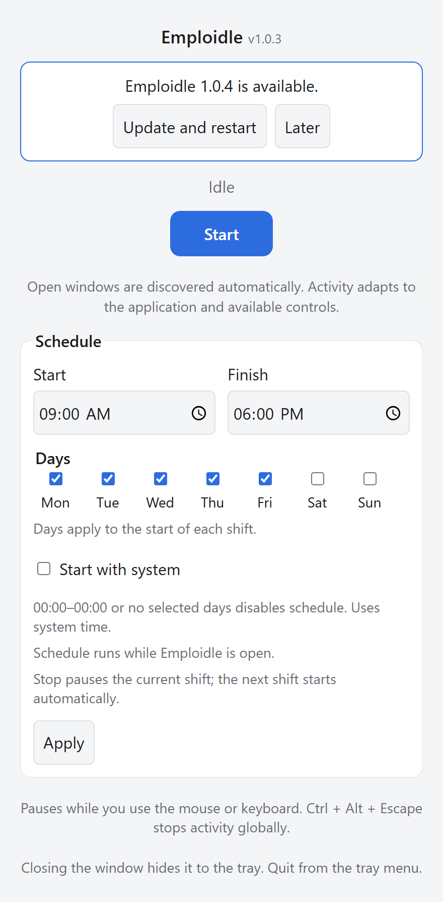

<div align="center">


# Emploidle

A desktop anti-idle activity simulator with automatic window discovery, varied cursor movement and application-aware activity.

[](https://github.com/khasky/emploidle/releases/latest) [](https://github.com/khasky/emploidle/actions/workflows/build.yml) [](LICENSE) 

[Download](https://github.com/khasky/emploidle/releases/latest) · [Features](#features) · [Quick start](#quick-start) · [Schedule](#schedule-and-startup) · [Platforms](#platform-notes) · [Development](#development)

<picture>
  <source media="(prefers-color-scheme: dark)" srcset="screenshots/dark-main.png">
  <source media="(prefers-color-scheme: light)" srcset="screenshots/light-main.png">
  
</picture>

<p><sub>Application interface with demonstration data. Screenshots follow your light or dark theme.</sub></p>

<sub>Built with <b>Tauri 2</b> · <b>Rust</b> · <b>HTML, CSS &amp; JavaScript</b></sub>

</div>

## Features

- **Varied activity.** Windows and existing browser tabs rotate without immediate repeats when alternatives are available. Browser reading and VS Code reviews run as complete scenarios; other windows use cursor routes through several different areas.
- **Automatic window discovery.** Open applications become available automatically, without window lists, permissions to configure or practice documents.
- **Application-aware actions on Windows.** Read existing browser tabs with smooth scrolling and a faster return, briefly select and clear visible text, or review VS Code Extensions, Explorer, folders and project files while restoring the editor's state.
- **Pauses for your input.** Physical keyboard or mouse activity interrupts the simulation. It resumes after 8 seconds without physical input; a global shortcut stops it immediately.
- **Weekly schedule.** Choose days of the week and start and finish times, including overnight shifts, and optionally launch Emploidle at login.
- **Tray controls and updates.** Start, stop or reopen the window from the tray. Builds with updater support offer signed updates with download progress and a restart button.

<details>
<summary><b>More screenshots: schedule, paused activity and updates</b></summary>

**Weekly schedule**

<picture>
  <source media="(prefers-color-scheme: dark)" srcset="screenshots/dark-schedule.png">
  <source media="(prefers-color-scheme: light)" srcset="screenshots/light-schedule.png">
  
</picture>

**Paused activity**

<picture>
  <source media="(prefers-color-scheme: dark)" srcset="screenshots/dark-paused.png">
  <source media="(prefers-color-scheme: light)" srcset="screenshots/light-paused.png">
  
</picture>

**Application update**

<picture>
  <source media="(prefers-color-scheme: dark)" srcset="screenshots/dark-update.png">
  <source media="(prefers-color-scheme: light)" srcset="screenshots/light-update.png">
  
</picture>

</details>

## Installation

Download an installer from [GitHub Releases](https://github.com/khasky/emploidle/releases/latest).

| Platform | Package | Installation |
| --- | --- | --- |
| Windows x64 | `-win-x64-setup.exe` or `-win-x64.msi` | Run the installer. |
| macOS Apple Silicon | `-mac-arm64.dmg` | Open the disk image and drag Emploidle to Applications. |
| macOS Intel | `-mac-x64.dmg` | Open the disk image and drag Emploidle to Applications. |
| Linux x64, X11 | `-linux-x64.AppImage`, `.deb` or `.rpm` | Make the AppImage executable and launch it, or install the package for your distribution. |

Filenames begin with `Emploidle-<version>`. See [Platform notes](#platform-notes) for permissions and session requirements.

### Updates

On startup, builds with updater support check GitHub Releases for a newer version. Choose **Update and restart** to download, verify and install it, or **Later** to keep working. A failed download or installation shows an error and a **Retry** button; offline checks leave the application usable.

Install a build containing the updater manually once. Earlier builds cannot update themselves. Signing and publishing instructions are in the [release guide](docs/releasing.md).

## Quick start

1. Open the applications you want to use, then launch Emploidle.
2. Press **Start**. The main window hides to the tray and activity begins; new windows are discovered automatically.
3. Use **Stop** in the window or tray menu to finish, or press **Ctrl + Alt + Escape** globally. On macOS, use **Control + Option + Escape**.

### Automatic activity

| Application or capability | Available actions |
| --- | --- |
| Open foreground windows | Curved cursor movement and hovering; accessible content rows are preferred. |
| Recognized document apps, supported sites and IDEs on Windows | Focus the window and scroll native accessibility controls, restoring the original scroll position after reading. |
| Existing tabs in supported Chromium browsers | Choose another available tab, save its scroll position, scroll smoothly toward the bottom and return faster, or briefly select and clear visible text. Long and infinite pages use a bounded reading interval before returning. Ambiguous tab identities are skipped. |
| VS Code and compatible editors exposing supported Windows accessibility controls | Review Extensions, Explorer and project folders, then open a visible text file in a pinned tab and close only that created tab. Existing preview tabs are preserved. Ambiguous layouts and multiple editor groups are skipped. The editor must already be running. |
| Supported mail inbox and sent-message lists | Scroll the list and return without opening messages or selecting text. Conversation views and chat pages that can mark messages read merely by activation are skipped. |
| Other communication views and unrecognized applications | Hover in an already active window; no message opening or typing. |

Actions depend on the controls exposed by each application. Unsupported actions are skipped. If a view changes concurrently, its newer position is preserved; a failed restoration stops further activity. Opening a temporary page can still affect the site's viewing history or activity log.

Comment entry, mail drafts and unread-channel navigation are currently unsupported. Emploidle does not type into external documents or forms, or substitute local practice documents for these operations.

### Window and tray controls

| Action | Result |
| --- | --- |
| Open the main window while running | Activity pauses; **Stop** remains available. |
| Close or minimize the main window to the tray | Running activity resumes. |
| Tray → **Show window**, **Start** or **Stop** | Control activity without leaving Emploidle open on the desktop. |
| Tray → **Quit** | Exit the application. |
| Green tray icon | Activity is enabled, including scheduled runs. |
| Orange tray icon | Paused for physical input, the open main window or a manual Stop. |
| Original blue tray icon | Not yet started or stopped automatically at the scheduled finish. |

Open windows and browser tabs are rediscovered between scenarios. Available targets are visited in shuffled rounds, avoiding the current window or tab when alternatives exist. Physical input interrupts the current scenario.

## Schedule and startup

Choose the days and set **Start** and **Finish** under **Schedule**, then press **Apply**. The schedule follows the system's local time, and Emploidle must remain open in the tray for it to run. Selected days identify when a shift starts; a Friday overnight shift finishes on Saturday even when Saturday is unchecked. Existing schedules keep all days selected.

| Setting or action | Behavior |
| --- | --- |
| `00:00`–`00:00` or no selected days | Scheduling is disabled. |
| Different start and finish times | A shift on each selected day, including shifts that cross midnight. |
| Manual **Stop** during a shift | Suppresses the remainder of that shift; the next shift can start automatically. |
| Manual **Start** outside a shift | Runs until **Stop** or the next scheduled finish. |
| **Start with system** | Launches in the background at user login; off by default. |

Schedule and startup preferences are stored in the application's config directory. Older saved window selections are ignored.

## Platform notes

| Platform | Requirements and limits |
| --- | --- |
| **Windows** | Native controls use the built-in Windows PowerShell UI Automation provider. Restorable scrolling, Chromium tab controls and IDE trees require compatible accessibility providers. Protected windows can reject access or focus changes. |
| **macOS** | Enable **Accessibility** and **Input Monitoring** under System Settings → Privacy & Security. Window discovery requires Accessibility; **Start** requests Input Monitoring when needed. Secure Input can restrict monitoring in protected applications. |
| **Linux** | Requires an **X11** session with XInput 2 and XTEST devices. Wayland is unsupported because global window control and physical input monitoring cannot be guaranteed through XWayland. |

Restorable scrolling, browser tabs and IDE tree actions currently require Windows. macOS and Linux support automatic discovery and cursor activity.

## Development

Requires the [Rust toolchain](https://rustup.rs), Node.js 22 or newer, and pnpm 9.15.4, pinned in [package.json](package.json). Install the [Tauri platform prerequisites](https://tauri.app/start/prerequisites/), including WebKitGTK on Linux.

```sh
pnpm install
pnpm dev:desktop      # run
pnpm build:desktop    # produce a bundled binary/installer
```

The frontend is static files under `src/`. Node.js runs development and release tooling. Local builds do not require the updater signing key.

### README screenshots

Regenerate the light and dark screenshots with Playwright:

```sh
pnpm exec playwright install chromium
pnpm screenshots
```

The capture script renders the same HTML, CSS and JavaScript as the desktop app at 2× resolution. A separate [Tauri mock](scripts/screenshots/tauri-mock.mjs) supplies demonstration data; capture does not read your open windows, change startup settings or run activity. Images are written to `screenshots/`. Main-window dimensions come from Tauri's config; schedule captures frame its controls, and paused/update captures show the corresponding main-window states.

### Checks

```sh
pnpm check:versions
pnpm lint
pnpm lint:workflow
pnpm test
cargo clippy --locked --manifest-path src-tauri/Cargo.toml --all-targets -- -D warnings
cargo test --locked --manifest-path src-tauri/Cargo.toml
```

Native Windows checks require an unlocked desktop without simultaneous keyboard or mouse input. After building the debug application, run:

```powershell
pnpm build:desktop --debug --ci --no-bundle -- -- --locked
pnpm test:windows
node scripts/windows-vscode.mjs
```

The VS Code check requires an installed editor. It uses a separate workspace, profile, shared-data directory and extension directory, with extensions and autosave disabled; the verification process is closed afterward.

### Versioning and releases

Commit messages and pull request titles follow [Conventional Commits](CONTRIBUTING.md#commit-messages). `pnpm release` derives the next version and [CHANGELOG.md](CHANGELOG.md) from commits, synchronizing `package.json`, Tauri's config and both Cargo files through [.versionrc.json](.versionrc.json).

Run `pnpm check:versions` to check version parity, or `pnpm release --dry-run` to preview a release. A pushed `v<version>` tag builds installers for Windows, Linux and macOS and prepares a draft GitHub Release. Follow the [release guide](docs/releasing.md) for signing, updater artifacts and publishing.

## Implementation details

<details>
<summary><b>Native activity and restoration</b></summary>

Windows accessibility inspection identifies visible controls, browser domains, scroll percentages and native element identities. Scrolling records the exact control and its before/after positions; restoration proceeds only while the view still matches the action's result. Tab cleanup addresses the created tab by its native runtime identity and preserves a user-selected different tab. VS Code reviews use the same native identities to restore the sidebar and editor selection, avoid replacing preexisting preview tabs, and preserve an editor if it has acquired user edits.

Existing HTTP and HTTPS tabs are identified through native accessibility controls without first activating them. Browser reading preserves the original scroll position and existing text selections. Supported mail list routes remain available for scrolling; conversation and notification routes are excluded when activation can change read states. These checks depend on the site's route and accessibility provider; unknown sites cannot provide a universal read-state guarantee. The older temporary-page helper restricts link transitions to visited HTTPS links on the same origin and recognized viewing routes. No extension or service credentials are required.

</details>

<details>
<summary><b>Process names and startup registration</b></summary>

Each launch generates a random 15-character process name, also used for the window title and tray tooltip. The text inside the window keeps the Emploidle name. If setting the random name fails, the application exits before starting its activity worker or window.

- **Windows:** the launcher briefly runs as `emploidle.exe`, starts a copy with a random `.exe` filename in the temporary directory's `emploidle-processes` folder, then exits. The copy omits the version resource so Task Manager uses its random filename; the original executable retains its metadata. Arguments and the working directory are preserved. Unlocked copies from earlier runs are removed on the next launch; the final copy remains until a later launch or temporary-file cleanup. Both debug and release builds run without a console window. WebView2 browser, renderer and utility processes appear under the application in Task Manager.
- **Linux:** changes the kernel process name through `/proc/self/comm`, visible in tools such as `ps -o comm`. The executable path and command line retain their original names.
- **macOS:** changes the kernel process name through `kern.procname`, preserving the application bundle and its signature. Views based on bundle metadata or command-line arguments may still show Emploidle.

Launch at login uses HKCU Run on Windows, a LaunchAgent on macOS or XDG autostart on Linux. Windows registration uses the original installed executable instead of its temporary renamed process copy.

</details>

## Contributing

See [CONTRIBUTING.md](CONTRIBUTING.md) for commit conventions and verification commands. Report bugs and request features through [GitHub Issues](https://github.com/khasky/emploidle/issues).

## License

[MIT](LICENSE) · Copyright © 2026 Khasky
